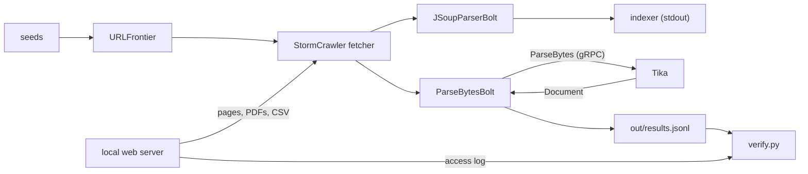

# Tika demo

StormCrawler fetches pages, PDFs and a CSV file from a local web server and sends their
bytes to Apache Tika over gRPC. Tika's `ParseBytes` call parses those bytes and returns a
typed `Document` with metadata and parse status. The bolt that talks to Tika uses only the
classes generated from Tika's proto files.

A crawler already holds the bytes of every page it fetches. With `ParseBytes`, Tika parses
those exact bytes and never downloads the page a second time. The checker, `verify.py`,
confirms it: the web server logs one GET per URL, and the SHA-256 that ParseBytesBolt computes
over the bytes it sends equals `origin.sha256` in Tika's reply.

`ParseBytes` and `Document` are not released yet. The demo builds Tika from the branch
[`tika-demo`](https://github.com/ai-pipestream/tika/tree/tika-demo) on a fork: Apache Tika
`main` plus the commits of
[TIKA-4766](https://issues.apache.org/jira/browse/TIKA-4766) (the `Document`) and
[TIKA-4795](https://issues.apache.org/jira/browse/TIKA-4795) (`ParseBytes`). `tika_server_sha`
in [`sample-run/manifest.txt`](sample-run/manifest.txt) is the Tika commit of the recorded run.

Some metadata values arrive typed, such as `xmpTPg:NPages` of a PDF as an integer. The type
of a key comes from the Tika class that declares it: the CSV parser declares `csv:num-rows`
as an integer. Tika parses in separate parser processes. Only those processes load the CSV
parser, so the gRPC server does not know the type of `csv:num-rows`. With
`"metadata-list": { "typedValues": true }` in [`tika/config.template.json`](tika/config.template.json),
the parser processes report the value types of the keys they wrote
([TIKA-4969](https://issues.apache.org/jira/browse/TIKA-4969)). The TIKA-4766 commits use
those types in the `Document`, so the server returns `csv:num-rows` as an integer. Without
the setting, it returns the value as a string.

## How it works



## What the checker verifies

- Each seeded or discovered URL produces one result, with no RPC or parse errors.
- Correlation IDs, source URLs, byte sizes and truncation flags match the request.
- The SHA-256 that ParseBytesBolt computes equals `origin.sha256` in Tika's reply; for the
  PDFs and the CSV file, it also equals the SHA-256 of the file on disk.
- The access log contains one GET for each document URL.
- `testPDF.pdf` returns the expected title and author, a creation date and an integer page count.
- A PDF served without an extension as `application/octet-stream` is detected as a PDF.
- The PDF with attachments and the PDF with an owner password parse successfully.
- `fixture.csv` has a header line and 11 data rows. Tika counts the header, so `csv:num-rows`
  is the integer 12.

See [`verify.py`](verify.py) for the checks and [`sample-run/`](sample-run/) for a recorded run.

## What this demo does not show

- `Document` carries no extracted text and no embedded documents. StormCrawler's own
  `JSoupParserBolt` still extracts the text and links of HTML pages; `ParseBytesBolt` only
  writes Tika's replies to `out/results.jsonl`.
- The request carries no content type or charset, so Tika detects both from the bytes. ASCII
  HTML without a declared charset comes back as `text/html; charset=windows-1252`.
- For the PDF with attachments, `parsers_used` lists the parsers that read the embedded files,
  but the `Document` has no field for them.

## Run it

Requires Java 17+, Maven, Docker and Python 3, on Linux or macOS; on Windows use WSL2. Docker
runs URLFrontier, the service that holds the crawl queue. The web server's default host name
is a nip.io name, which resolves to 127.0.0.1 through public DNS.
[`sample-run/manifest.txt`](sample-run/manifest.txt) records the system and versions of the
recorded run.

Build tika-grpc from the branch, in a folder next to this repository:

```sh
git clone https://github.com/dpol1/tika-demo.git
git clone --depth 1 --branch tika-demo https://github.com/ai-pipestream/tika.git tika-4795-demo
cd tika-4795-demo
./mvnw -q clean package dependency:build-classpath -pl tika-grpc -am -Pfast \
  -Dmdep.includeScope=runtime -Dmdep.outputFile="$PWD/tika-grpc/target/cp.txt"
```

Then run the demo:

```sh
cd ../tika-demo
./run.sh
```

`run.sh` starts Tika, URLFrontier and the web server, crawls for two minutes, then runs the
checker. `run_seconds` in [`sample-run/manifest.txt`](sample-run/manifest.txt) is the total
time of the recorded run, without the first Maven and Docker downloads. Results and logs go to `out/`; exit code
0 means all checks passed. The last lines of the checker's output:

```
PASS  small pdf metadata: {'content_type': 'application/pdf', 'title': 'ParseBytes fixture'}
PASS  csv row count typed: {'content_type': 'text/csv; charset=windows-1252; delimiter=comma', 'rows': 12, 'rows_type': 'integers'}

ALL CHECKS PASSED
```

URLFrontier uses port 7072 and the web server port 8099. Tika uses port 50052, or a free port
if 50052 is taken. While the demo runs, Tika listens on all interfaces without TLS.

Environment variables:

- `TIKA_DIR`: the Tika checkout built with the command above (default `../tika-4795-demo`).
- `TIKA_TARGET`: `host:port` of a tika-grpc server you started, used instead of a local one.
- `TIKA_PORT`: local Tika port (default 50052).
- `RUN_MINUTES`: crawl duration in minutes (default 2).
- `FIXTURE_HOST`: host name of the web server (default a nip.io name for 127.0.0.1). Offline,
  add a name for 127.0.0.1 to `/etc/hosts` and use it here.
- `FIXTURE_BIND`: address the web server listens on (default 127.0.0.1).
- `SC_VERSION`, `STORM_VERSION`, `URLFRONTIER_VERSION`: StormCrawler 3.7.0, Storm 2.8.9 and
  URLFrontier 2.5 by default.

If it fails, `out/tika-server.log` and `out/topology.log` hold the logs of Tika and of the
crawl. The script stops early when the host name does not resolve, when Tika is not built,
when the protos in `proto/` differ from the ones in `TIKA_DIR`, or when a server does not open
its port.

## Using your own tika-grpc server

`TIKA_TARGET=host:port ./run.sh` skips the local Tika. The server must run the build above,
configured like [`tika/config.template.json`](tika/config.template.json): the digester supplies
`origin.sha256` for the checksum check. `typedValues` makes Tika return `csv:num-rows` as an
integer, which the CSV check needs. `plugin-roots` must be in the configuration file because
the parser processes Tika starts do not see the command-line option.
[`run.sh`](run.sh) shows the command that starts the server. For a Tika server on another
machine, set `FIXTURE_HOST` to a host name it can reach and `FIXTURE_BIND=0.0.0.0`. The
recorded run does not cover this mode.

## Changing the demo

[`gen-stubs.sh`](gen-stubs.sh) regenerates `src/main/java/org/apache/tika/grpc/v2` from the
protos in `proto/`. [`test_verify.py`](test_verify.py) runs the checker against broken runs and
checks that `sample-run/verify.txt` matches the checker's output. CI runs both on every push.
The `run` workflow, started by hand from the Actions tab, builds Tika from the `tika-demo`
branch, runs `run.sh` and uploads `out/` as a workflow artifact.

When the `tika-demo` branch changes its protos, copy them into `proto/`, run `gen-stubs.sh` and
update the commit in [NOTICE](NOTICE).

## License

[Apache License 2.0](LICENSE). The protos, the generated classes and the three test PDFs come
from Apache Tika; see [NOTICE](NOTICE).
